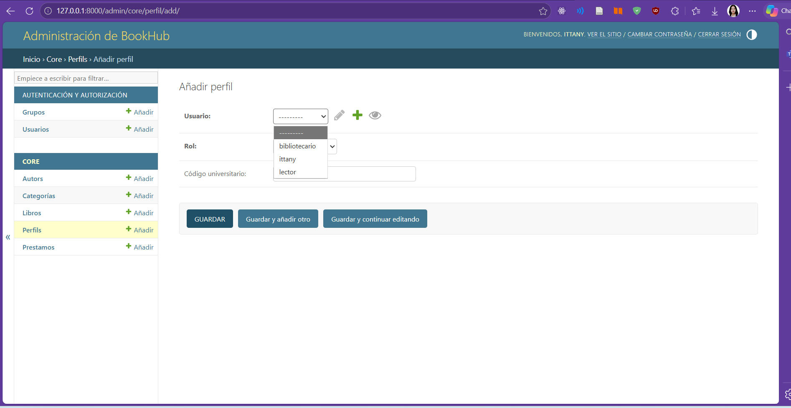
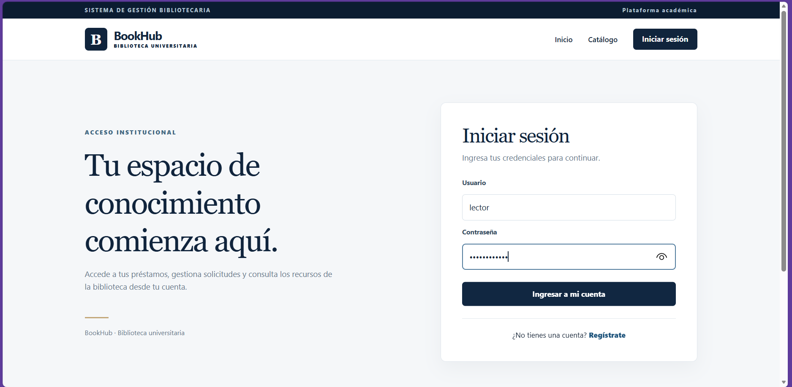
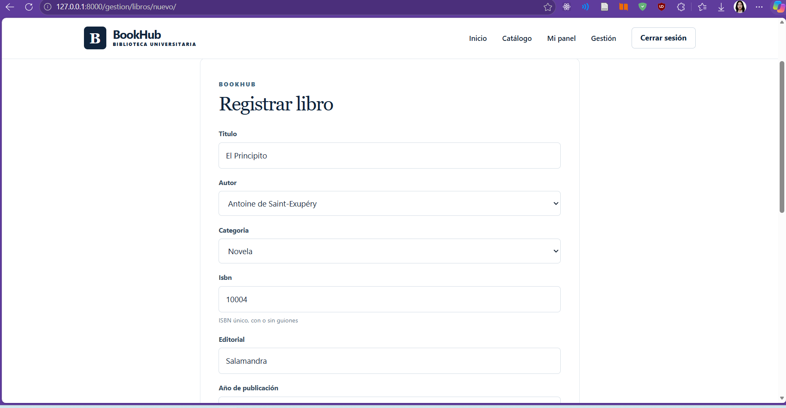
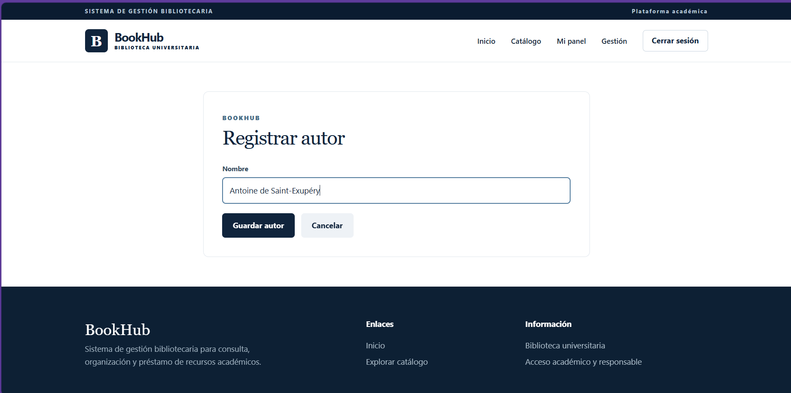
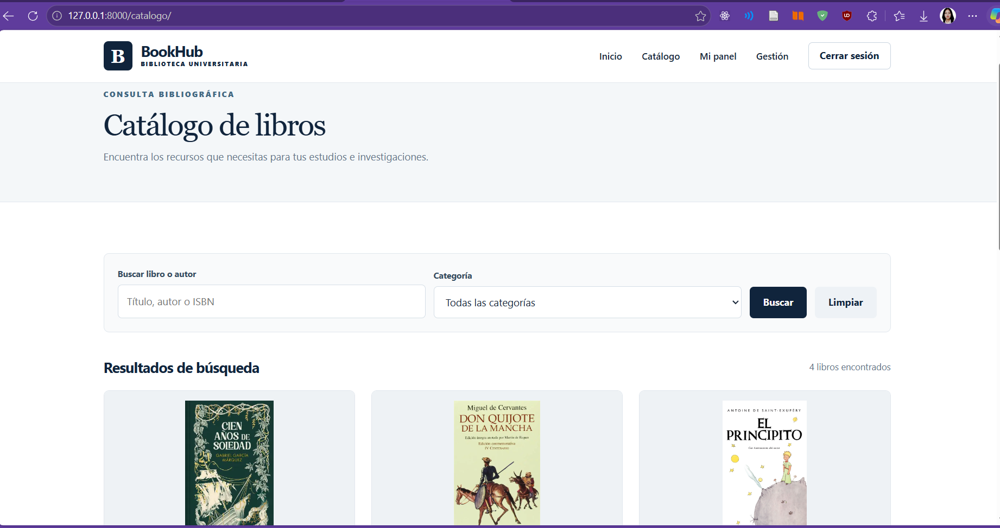
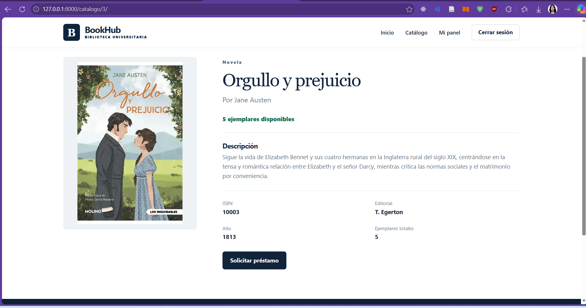
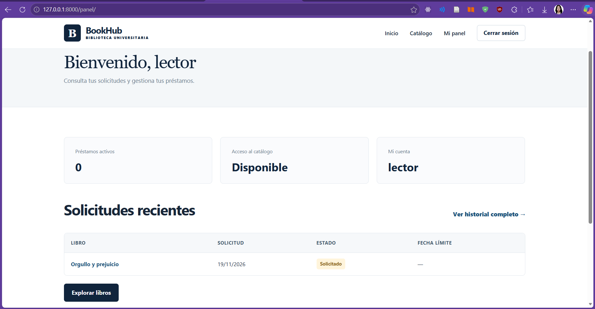

# BookHub — Sistema de Gestión de Biblioteca

BookHub es una aplicación web desarrollada con **Python y Django 5.x**, orientada a la administración y gestión de una biblioteca. El sistema permite gestionar libros, autores, categorías, préstamos y devoluciones, mediante un esquema de autenticación y control de acceso basado en roles.

La aplicación cuenta con una interfaz web moderna, un catálogo público y paneles diferenciados para los tres tipos de usuarios: **Administrador, Bibliotecario y Lector**.

## 1. Tecnologías utilizadas

- **Backend:** Python 3.14 y Django 5.2.19
- **Frontend:** HTML5, CSS3 y JavaScript
- **Base de datos:** SQLite
- **Autenticación:** Sistema de autenticación de Django
- **Herramientas:** Git, GitHub y Visual Studio Code
- **Dependencias adicionales:** django-extensions y python-decouple

## 2. Funcionalidades principales

### Administrador
- Acceso al panel de administración.
- Gestión del catálogo de libros.
- Registro y administración de autores y categorías.
- Supervisión de préstamos y devoluciones.
- Acceso a las funcionalidades administrativas del sistema.

### Bibliotecario
- Acceso a un panel de gestión bibliotecaria.
- Registro y actualización de libros.
- Gestión de ejemplares disponibles.
- Administración de solicitudes de préstamos.
- Registro y seguimiento de devoluciones.

### Lector
- Registro e inicio de sesión.
- Consulta del catálogo de libros.
- Búsqueda de libros disponibles.
- Solicitud de préstamos.
- Consulta del historial de préstamos.

### Acceso público
- Visualización de la página principal.
- Exploración del catálogo de libros.
- Consulta de información bibliográfica.
- Acceso a las páginas de registro e inicio de sesión.

## 3. Requisitos previos

Para ejecutar el proyecto se requiere:

- Python 3.11 o superior (probado con Python 3.14).
- Git.
- Visual Studio Code u otro editor de código.
- PowerShell, Git Bash o una terminal equivalente.

## 4. Instalación y ejecución

### Paso 1. Clonar el repositorio

```bash
git clone https://github.com/Ittany/BookHub.git
cd BookHub
```

### Paso 2. Crear un entorno virtual

```bash
python -m venv .venv
```

Activar el entorno virtual según el sistema operativo:

**Windows PowerShell:**

```powershell
.\.venv\Scripts\Activate.ps1
```

**Windows Git Bash:**

```bash
source .venv/Scripts/activate
```

**Linux / macOS:**

```bash
source .venv/bin/activate
```

### Paso 3. Instalar las dependencias

```bash
python -m pip install -r requirements.txt
```

### Paso 4. Configurar las variables de entorno

Si el proyecto incluye el archivo `.env.example`, crear un archivo `.env` a partir de él y configurar las variables requeridas por `config/settings.py`.

El archivo `.env` no debe subirse a GitHub porque puede contener información confidencial.

### Paso 5. Crear y actualizar la base de datos

```bash
python manage.py makemigrations
python manage.py migrate
```

### Paso 6. Crear un superadministrador

```bash
python manage.py createsuperuser
```

Ingresar el nombre de usuario, correo electrónico y contraseña solicitados.

### Paso 7. Iniciar el servidor

```bash
python manage.py runserver
```

Abrir en el navegador:

**http://127.0.0.1:8000/**

Para ingresar al panel administrativo de Django:

**http://127.0.0.1:8000/admin/**

## 5. Roles y permisos

El sistema contempla tres tipos de usuarios:

| Rol | Descripción |
|---|---|
| Administrador | Supervisa las operaciones del sistema y administra los recursos bibliotecarios. |
| Bibliotecario | Gestiona el catálogo, los préstamos y las devoluciones. |
| Lector | Consulta libros, solicita préstamos y revisa su historial. |

El primer administrador se crea mediante el comando `createsuperuser`.

Los lectores pueden registrarse desde la interfaz pública del sistema. Los bibliotecarios pueden ser creados por el administrador y configurados con el rol correspondiente.

## 6. Estructura del proyecto

```text
BookHub/
├── capturas/                # Capturas de pantalla
├── config/                  # Configuración principal de Django
├── core/                    # Aplicación y lógica de negocio
├── media/                   # Archivos multimedia locales
├── static/                  # CSS, JavaScript y recursos estáticos
├── templates/               # Plantillas HTML
│   ├── core/                # Interfaces del sistema
│   └── registration/        # Inicio de sesión y autenticación
├── .env.example             # Ejemplo de configuración
├── .gitignore               # Archivos excluidos de Git
├── manage.py                # Administración de Django
├── README.md                # Documentación del proyecto
└── requirements.txt         # Dependencias de Python
```

**Nota:** El entorno virtual (`.venv/`), la base de datos local (`db.sqlite3`) y los archivos multimedia generados se excluyen del repositorio mediante `.gitignore`.

## 7. Capturas de pantalla

A continuación se presentan las principales interfaces y funcionalidades del sistema BookHub.

### 7.1. Autenticación y paneles principales

| Inicio de sesión | Panel de administrador |
|:---:|:---:|
|  |  |

| Interfaz principal | Panel de administración |
|:---:|:---:|
|  |  |

### 7.2. Paneles según el tipo de usuario

| Panel de bibliotecario | Panel de lector |
|:---:|:---:|
|  |  |

### 7.3. Gestión del catálogo

El sistema permite registrar y administrar la información bibliográfica, incluyendo libros, autores y categorías.

| Registro de libros | Registro de autores | Catálogo de libros |
|:---:|:---:|:---:|
|  |  |  |

### 7.4. Préstamos e historial

Los lectores pueden solicitar préstamos y consultar su historial, mientras que el personal autorizado administra las solicitudes y devoluciones.

| Solicitud de préstamo | Historial de préstamos |
|:---:|:---:|
|  |  |

## 8. Seguridad

BookHub utiliza los mecanismos de seguridad proporcionados por Django:

- Autenticación mediante usuario y contraseña.
- Control de acceso según el rol asignado.
- Protección de rutas que requieren autenticación.
- Protección CSRF en formularios.
- Almacenamiento seguro de contraseñas mediante los mecanismos de hash de Django.
- Separación de permisos entre administrador, bibliotecario y lector.
- Exclusión de archivos sensibles mediante `.gitignore`.