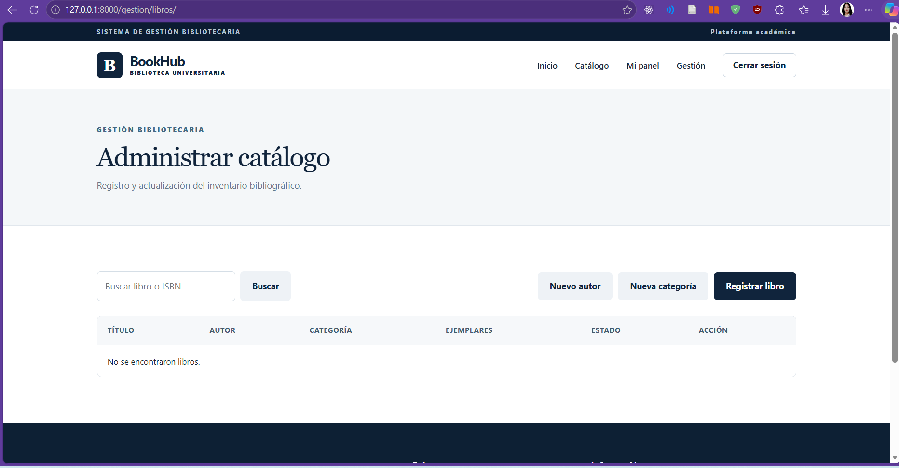
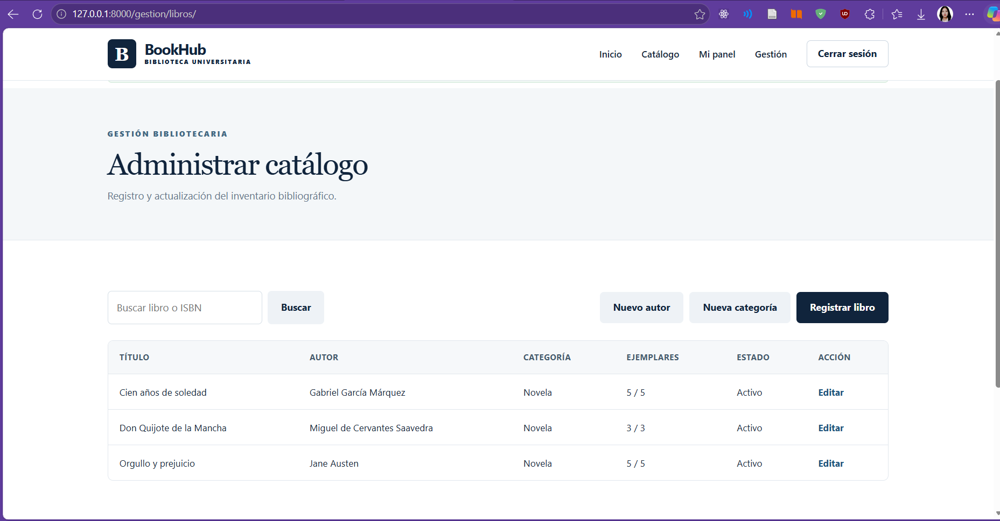
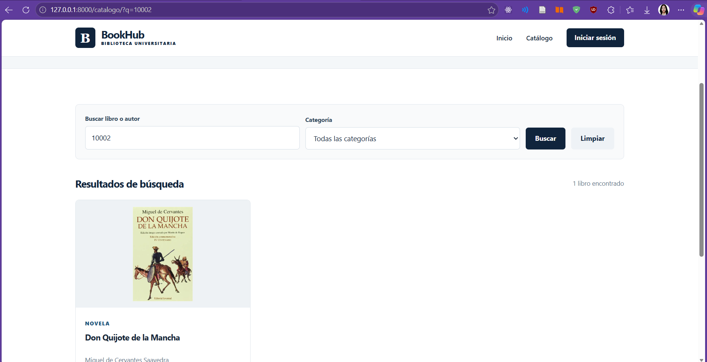

# BookHub — Sistema backend Django 5.x

Práctica de gestión de datos y seguridad en Django 5.x. El proyecto implementa un sistema de roles (Administrador, Bibliotecario y Lector) para la gestión de una biblioteca, incluyendo autores, libros, préstamos e historial.

## Stack

- Python 3.14
- Django 5.2.19
- SQLite
- django-extensions, python-decouple

## Requisitos previos

- Python 3.11+ (probado en 3.14)
- Git
- PowerShell o terminal equivalente

## Instalación

```bash
git clone https://github.com/Ittany/BookHub.git
cd BookHub

python -m venv venv

# Windows PowerShell:
.\venv\Scripts\Activate.ps1
# Linux/macOS:
source venv/bin/activate

pip install -r requirements.txt
python manage.py migrate
python manage.py createsuperuser
python manage.py runserver

BookHub_/
├── .venv/               # Entorno virtual
├── capturas/            # Capturas de pantalla del sistema
├── config/              # Configuración principal de Django
├── core/                # Aplicación principal (lógica de negocio)
├── media/               # Archivos subidos (ej. portadas)
├── static/              # Archivos estáticos (CSS, JS, imágenes)
├── templates/           # Plantillas HTML
│   ├── core/
│   └── registration/    # Plantillas de autenticación (login.html)
├── .env.example         # Ejemplo de variables de entorno
├── .gitignore
├── db.sqlite3           # Base de datos SQLite
├── manage.py
├── README.md
└── requirements.txt

Capturas de Pantalla
A continuación se muestra el flujo y las interfaces del sistema (ubicadas en la carpeta capturas/).

| Iniciar Sesión | Panel de Administrador |
| :---: | :---: |
|  |  | 
| Iniciar Sesión | Panel de Bibliotecario |

|  | |

| Panel de Bibliotecario | Panel de Lector |
| :---: | :---: |
|  |  |

### Gestión de Catálogo

| Agregar Libro | Agregar Autor || Catálogo agregados |
| :---: | :---: |
|  |  | |

### Préstamos y Historial

| Préstamo de Libro | Historial de Libros Prestados |
| :---: | :---: |
|  |  |